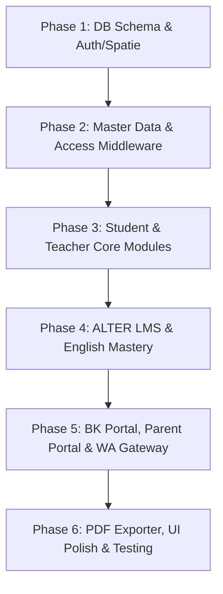

# ALTURA (Alto's System) — Comprehensive Implementation Roadmap & Architecture Blueprint

> **Platform**: Manajemen Akademik & Operasional Bimbingan Belajar Terpadu  
> **Framework**: Laravel 11.x / 13.x (PHP 8.4)  
> **Frontend Stack**: Blade Templates, Tailwind CSS, Alpine.js, Plyr.js, html5-qrcode, Chart.js  
> **Roles (5 Roles)**: `admin`, `guru`, `guru_bk`, `siswa`, `orang_tua`  
> **Status**: Architecture Planning & Blueprint Phase

---

## TABLE OF CONTENTS
1. [Core Principles & Architectural Tenets](#1-core-principles--architectural-tenets)
2. [Phased Development Roadmap (6 Phases)](#2-phased-development-roadmap-6-phases)
3. [Exact File Structure](#3-exact-file-structure)
4. [Database Migration Blueprint](#4-database-migration-blueprint)
5. [Route Architecture (routes/web.php)](#5-route-architecture)
6. [Business Logic & Service Architecture](#6-business-logic--service-architecture)
7. [Testing & Verification Strategy](#7-testing--verification-strategy)

---

## 1. CORE PRINCIPLES & ARCHITECTURAL TENETS

1. **Zero E-Commerce / Zero Paywall / Zero Captcha**:
   - Access to all Tryouts, ALTER LMS courses, and English modules is fully governed by the student's registered Class & Major.
   - Enforced automatically at the HTTP kernel level via `AutoEnrollmentAccess` middleware.
2. **One-Page Learning Experience (ALTER LMS)**:
   - Split-screen / responsive stacked view: Top/Left video engine powered by Plyr.js embedding YouTube (`modestbranding=1&rel=0&controls=1`).
   - Bottom/Right clean essay problem viewer with high-resolution problem crop screenshots (`problem_image_path`). Students solve questions directly in their physical notebooks without cumbersome LMS form fields.
3. **Hybrid English Mastery Workflow**:
   - **Vocab (400 words)**: Digital CBT quiz engine with automatic instant evaluation per module.
   - **Storytelling & Wacana**: In-person oral examination. Students book slots *strictly* with their locked Mentor (`mentor_id`). Mentors evaluate live using an interactive digital rubric on mobile or tablet.
4. **Desk-side Teacher Attendance Scanner**:
   - Student dashboard renders a dynamic, secure QR Identity code generated from their student token.
   - Teachers use their device camera via `html5-qrcode` to scan desk-by-desk.
   - Real-time calculation of student attendance percentages and instant color coding:
     - 🟢 **Normal**: $\ge 90\%$
     - 🟡 **Warning**: $75\% - 89\%$
     - 🔴 **Critical**: $< 75\%$
5. **Proactive Counselor (BK) Flagging Engine**:
   - Automated detection of consecutive late sessions ($\ge 3$ consecutive tardiness), critical unexcused absences (alfa), or lagging module targets.
   - Direct notification queue into Counselor Kak Nisa's inbox without manual spreadsheet recalculations.
6. **Parent Engagement & WhatsApp Gateway**:
   - Outbound notifications for attendance check-ins, tryout scorecards, and BK critical alerts via an asynchronous WhatsApp Gateway client.
   - Parent portal for monitoring child academic metrics and booking dedicated counseling sessions with Kak Nisa.

---

## 2. PHASED DEVELOPMENT ROADMAP (6 PHASES)



### Phase 1: DB Schema Foundation, Spatie Roles & Authentication Architecture
- **Objective**: Establish rock-solid database tables, role definitions, and session-persistent authentication.
- **Key Tasks**:
  1. Install and configure `spatie/laravel-permission` for 5 roles: `admin`, `guru`, `guru_bk`, `siswa`, `orang_tua`.
  2. Implement database migrations for core tables (`majors`, `academic_classes`, `teachers`, `students`, `users`).
  3. Configure persistent authentication session (`remember_token`, 120-minute sliding window) and role-based login redirection (`RedirectIfAuthenticatedByRole`).
  4. Create seeders for primary test users across all 5 roles (e.g., Admin Alto, Kak Nisa BK, Demo Teachers, Demo Students, Demo Parents).
- **Deliverables**:
  - Migrations 1-6 running cleanly without foreign key mismatch.
  - Spatie seeders with role assignments.
  - Authentication views with responsive, modern aesthetic.

---

### Phase 2: Master Data Management & Access Middleware Architecture
- **Objective**: Build administrative CRUD modules for academic master data and implement auto-enrollment access layers.
- **Key Tasks**:
  1. Build Admin Master Data Controllers & Views:
     - Majors (IPA, IPS, SMK, SNBT mandatory switch).
     - Academic Classes (linked to Majors).
     - Teachers (NIP, Subject Specialization, Mentor status).
     - Students (NISN, Major, Class, locked Mentor assignment, Counselor assignment, Parent Phone).
  2. Create Custom Middleware:
     - `AutoEnrollmentAccess`: Automatically verifies student's Class and Major when accessing courses or tryouts without checkout or payment barriers.
     - `EnsureActiveStudent`: Verifies `status_active = true`.
     - `EnsureStudentMentorLocked`: Prevents cross-submission or booking with unauthorized teachers.
  3. Build bulk import/export scaffolding using `maatwebsite/excel` for Student and Master data.
- **Deliverables**:
  - Functional Admin CRUD screens with instant search, filter, and pagination.
  - Custom middleware unit and feature tests validating access control.

---

### Phase 3: Student & Teacher Core Modules (QR Attendance & Single Student 360°)
- **Objective**: Deliver the desk-side QR attendance scanning workflow and comprehensive single-student profile.
- **Key Tasks**:
  1. Student Dynamic QR Generator:
     - Implement student QR identity view using `simplesoftwareio/simple-qrcode` or SVG render.
     - Student attendance history tab with live percentage calculation.
  2. Teacher Desk-side QR Scanner:
     - Build mobile-optimized Teacher Scanner view integrating `html5-qrcode`.
     - Implement quick check-in API endpoint (`POST /guru/presensi/scan`) with session validation and duplicate scan prevention.
     - Manual attendance logger for session adjustments (`hadir`, `terlambat`, `sakit`, `izin`, `alfa`).
  3. Single Student 360° Profile (`Profil 360° Siswa`):
     - Comprehensive dashboard for Teachers and Mentors aggregating Attendance, Tryout trends, ALTER progress, and English Mastery status on a single page.
  4. Consultation Slot & Booking Engine (Tentoring / Mapel):
     - Mentors schedule open slots with maximum capacity limits.
     - Students discover and book slots with automatic remaining quota deduction.
- **Deliverables**:
  - Tested mobile camera QR scanner interface.
  - Single student 360-degree analytical view for mentors.
  - Full consultation booking workflow.

---

### Phase 4: ALTER LMS & English Mastery (Hybrid Assessment)
- **Objective**: Build the split-screen LMS experience and two-tier English mastery evaluation.
- **Key Tasks**:
  1. ALTER LMS "One-Page Learning":
     - Implement `alter_courses`, `alter_chapters`, and `alter_problems` database structures.
     - Develop split-screen / responsive stacked view with Plyr.js wrapping YouTube embeds (`modestbranding=1&rel=0&controls=1`).
     - Display image-based essay problems list with high-res crop viewer for notebook solving.
     - Implement student progress tracking per chapter.
  2. English Vocab CBT (400 Words Bank):
     - Interactive digital CBT quiz interface grouped into modular batches.
     - Auto-grading algorithm scoring on submit; storing percentage and pass/fail flag (`vocab_quiz_results`).
  3. Speaking & Wacana Hybrid Engine:
     - Digital Task Card viewer displaying Storytelling and Wacana scripts.
     - Mentor Oral Exam Booking interface (restricted strictly to the student's assigned Mentor).
     - Live Digital Rubric for Teachers: touch-friendly slider/number scoring (Pronunciation, Fluency, Vocabulary, Comprehension) with qualitative notes.
- **Deliverables**:
  - Distraction-free one-page ALTER LMS player.
  - Digital Vocab quiz engine with instant auto-grading.
  - Live oral assessment rubric for mobile devices.

---

### Phase 5: Counselor BK, Parent Portal & WhatsApp Gateway Automation
- **Objective**: Deliver counselor monitoring tools, automated student flagging, parent transparency, and WhatsApp notification dispatch.
- **Key Tasks**:
  1. Counselor BK Dashboard (Kak Nisa):
     - Attendance health matrix with color-coded alerts (Green, Yellow, Red).
     - Automatic Flagging Engine (`attendance_flags`): Cron / Event listener identifying students with 3x consecutive tardiness, high absences, or lagging submissions.
     - BK Counseling session manager and student case notes workflow.
  2. Parent / Guardian Portal (`orang_tua`):
     - Parent dashboard displaying child attendance recap, latest tryout scores, and module completion.
     - Consultation booking interface for parent-to-counselor meetings.
     - Direct WhatsApp quick-links to assigned Mentor and Counselor.
  3. WhatsApp Gateway Integration:
     - Guzzle HTTP client service (`WhatsAppGatewayService`) with retry mechanisms and template formatting.
     - Event triggers:
       - Session attendance scan alert sent to parent phone.
       - Tryout score card release notification.
       - Critical BK attendance warning alerts.
     - Persistent delivery logging in `wa_message_logs`.
- **Deliverables**:
  - Proactive Counselor alerting inbox.
  - Intuitive parent dashboard.
  - Production-ready WhatsApp gateway client with audit logs.

---

### Phase 6: PDF Exporter, UI Polish, Testing & Production Readiness
- **Objective**: Finalize polished PDF exports, responsive design aesthetics, end-to-end tests, and performance tuning.
- **Key Tasks**:
  1. PDF Report Generator (`barryvdh/laravel-dompdf`):
     - Official Tryout Score Report PDF featuring subtest score tables (TPS, Indo, Inggris, Matematika), average score, rank/percentile, and Alto's official stamp/header.
     - Semester Student Comprehensive Progress Report PDF.
  2. Front-end Polish & Aesthetics:
     - Elegant dark/light accents, micro-interactions, responsive sidebars for all 5 roles.
     - Interactive SNBT radar charts and attendance trend graphs using Chart.js.
  3. Comprehensive Automated Testing:
     - Feature tests for authentication, role boundaries, and Spatie policies.
     - Unit tests for `AutoEnrollmentAccess`, `AttendanceCalculatorService`, and `StudentFlaggingService`.
     - Feature tests for QR check-in API and Vocab auto-grading.
  4. Code Formatting & Optimization:
     - Execute Laravel Pint (`vendor/bin/pint --format agent`).
     - Optimize database queries with proper Eloquent eager loading (`with(...)`) to eliminate N+1 queries.
- **Deliverables**:
  - Pixel-perfect PDF report downloads.
  - Passing automated PHPUnit test suite.
  - Formatted, production-ready codebase.

---

## 3. EXACT FILE STRUCTURE

### 3.1 Database Migrations (`database/migrations/`)
1. `0001_01_01_000000_create_users_table.php` (Core user table + remember token)
2. `0001_01_01_000001_create_cache_table.php`
3. `0001_01_01_000002_create_jobs_table.php`
4. `2026_01_01_000010_create_permission_tables.php` (Spatie Laravel-Permission)
5. `2026_01_01_000020_create_majors_table.php`
6. `2026_01_01_000021_create_academic_classes_table.php`
7. `2026_01_01_000022_create_teachers_table.php`
8. `2026_01_01_000023_create_students_table.php`
9. `2026_01_01_000024_create_attendances_table.php`
10. `2026_01_01_000025_create_alter_courses_table.php`
11. `2026_01_01_000026_create_alter_chapters_table.php`
12. `2026_01_01_000027_create_alter_problems_table.php`
13. `2026_01_01_000028_create_vocab_words_table.php`
14. `2026_01_01_000029_create_vocab_quiz_results_table.php`
15. `2026_01_01_000030_create_speaking_tasks_table.php`
16. `2026_01_01_000031_create_speaking_bookings_table.php`
17. `2026_01_01_000032_create_tryouts_table.php`
18. `2026_01_01_000033_create_tryout_scores_table.php`
19. `2026_01_01_000034_create_consultation_slots_table.php`
20. `2026_01_01_000035_create_consultation_bookings_table.php`
21. `2026_01_01_000036_create_attendance_flags_table.php`
22. `2026_01_01_000037_create_wa_message_logs_table.php`

---

### 3.2 Eloquent Models (`app/Models/`)
1. `User.php` (HasRoles trait, relations to Student, Teacher, Parent)
2. `Major.php` (HasMany AcademicClasses, HasMany AlterCourses, HasMany Students)
3. `AcademicClass.php` (BelongsTo Major, HasMany Students)
4. `Teacher.php` (BelongsTo User, HasMany Mentees [Students], HasMany ConsultationSlots, HasMany SpeakingBookings)
5. `Student.php` (BelongsTo User, BelongsTo Major, BelongsTo AcademicClass, BelongsTo Mentor [Teacher], BelongsTo Counselor [User], HasMany Attendances, HasMany TryoutScores, HasMany VocabQuizResults, HasMany SpeakingBookings, HasMany AttendanceFlags)
6. `Attendance.php` (BelongsTo Student, BelongsTo ScannedBy [Teacher])
7. `AlterCourse.php` (BelongsTo Major, HasMany AlterChapters)
8. `AlterChapter.php` (BelongsTo AlterCourse, HasMany AlterProblems)
9. `AlterProblem.php` (BelongsTo AlterChapter)
10. `VocabWord.php` (Scope by module number)
11. `VocabQuizResult.php` (BelongsTo Student)
12. `SpeakingTask.php` (HasMany SpeakingBookings)
13. `SpeakingBooking.php` (BelongsTo Student, BelongsTo Mentor [Teacher], BelongsTo SpeakingTask)
14. `Tryout.php` (HasMany TryoutScores)
15. `TryoutScore.php` (BelongsTo Student, BelongsTo Tryout)
16. `ConsultationSlot.php` (BelongsTo Mentor [Teacher/User], HasMany ConsultationBookings)
17. `ConsultationBooking.php` (BelongsTo ConsultationSlot, BelongsTo Student, BelongsTo Parent [User])
18. `AttendanceFlag.php` (BelongsTo Student)
19. `WaMessageLog.php` (Scopes for sent/failed logs)

---

### 3.3 HTTP Controllers (`app/Http/Controllers/`)

#### Authentication & Common
- `Auth/AuthenticatedSessionController.php` (Login, Logout, Persistent Remember Me)
- `Auth/RedirectController.php` (Directs user to role dashboard upon login)

#### 1. Siswa Portal (`app/Http/Controllers/Student/`)
- `Student/DashboardController.php` (Live schedule banner, target setoran widget, metrics)
- `Student/AttendanceController.php` (Dynamic QR Identity, attendance log & percentages)
- `Student/AlterLearningController.php` (One-page player: Plyr video + essay problem viewer)
- `Student/CurriculumController.php` (Filtered curriculum based on Major)
- `Student/VocabQuizController.php` (CBT interface, submission & instant auto-grading)
- `Student/SpeakingTaskController.php` (Digital task cards for Storytelling & Wacana)
- `Student/SpeakingBookingController.php` (Booking oral exam with locked mentor)
- `Student/TryoutController.php` (Score analytics, radar chart data, download report link)
- `Student/ConsultationController.php` (Browse open slots, book mapel tentoring)
- `Student/ProfileController.php` (Integrated academic profile)

#### 2. Guru Portal (`app/Http/Controllers/Teacher/`)
- `Teacher/DashboardController.php` (Teaching schedule, mentee groups, submission queue)
- `Teacher/ScannerController.php` (HTML5 QR camera scanner & scan check-in API)
- `Teacher/AttendanceSessionController.php` (Session management & manual attendance edit)
- `Teacher/SingleStudentProfileController.php` (Profil 360° Siswa: TO, presensi, setoran, ALTER)
- `Teacher/OralRubricController.php` (Touch-friendly digital grading rubric for oral exam)
- `Teacher/VocabMonitoringController.php` (Monitor student vocab quiz results & progress)
- `Teacher/ConsultationSlotController.php` (Create and manage open tentoring slots)

#### 3. Guru BK Portal (`app/Http/Controllers/Counselor/`)
- `Counselor/DashboardController.php` (Color-coded attendance matrix: Green/Yellow/Red)
- `Counselor/AlertFlagController.php` (Automated tardiness/absence/vocab overdue queue)
- `Counselor/AttendanceReportController.php` (Automated % attendance summary)
- `Counselor/TargetRecapController.php` (Monthly student target achievement recap)
- `Counselor/BkConsultationController.php` (Manage BK discussion slots for students & parents)

#### 4. Orang Tua Portal (`app/Http/Controllers/Parent/`)
- `Parent/DashboardController.php` (Child attendance summary, TO average, submission status)
- `Parent/ChildProgressController.php` (Detailed attendance logs, TO breakdown, module progress)
- `Parent/BkConsultationController.php` (Book counseling session with Kak Nisa)
- `Parent/MentorContactController.php` (Direct WhatsApp bridge to Mentor & BK)

#### 5. Admin Portal (`app/Http/Controllers/Admin/`)
- `Admin/DashboardController.php` (System metrics, active users, operations overview)
- `Admin/MajorController.php` (CRUD Majors)
- `Admin/AcademicClassController.php` (CRUD Academic Classes)
- `Admin/TeacherController.php` (CRUD Teachers & Mentors)
- `Admin/StudentController.php` (CRUD Students, import/export Excel)
- `Admin/CounselorController.php` (CRUD Counselors & parent phone mappings)
- `Admin/TryoutController.php` (Manage Tryout packages & auto-enrollment settings)
- `Admin/AlterContentController.php` (Manage Courses, Chapters, YouTube IDs & Essay Problem SS)
- `Admin/EnglishMasteryController.php` (Manage 400 Vocab words bank & Speaking scripts)
- `Admin/ConsultationSlotController.php` (Global consultation slot schedule & broadcasts)
- `Admin/WhatsAppGatewayController.php` (Gateway configuration & message logs audit)
- `Admin/RolePermissionController.php` (Spatie roles & system configuration)

#### Reports & Exports
- `Report/TryoutReportController.php` (Generate & stream official Tryout PDF using DOMPDF)
- `Report/AcademicProgressReportController.php` (Generate student progress report PDF)

---

### 3.4 Custom Middleware (`app/Http/Middleware/`)
1. `AutoEnrollmentAccess.php`: Automatically validates student's Class and Major to grant full access to Tryouts and LMS courses without checkout barriers.
2. `EnsureStudentMentorLocked.php`: Ensures students can only book oral exams and check-ins with their designated `mentor_id`.
3. `EnsureActiveStudent.php`: Validates student active status (`status_active = true`).
4. `RedirectIfAuthenticatedByRole.php`: Redirects authenticated users to their designated role dashboard (`/siswa`, `/guru`, `/bk`, `/ortu`, `/admin`).

---

### 3.5 Core Services & Domain Engines (`app/Services/`)
1. `Services/WhatsAppGatewayService.php`:
   - Outbound HTTP API client for WhatsApp Gateway.
   - Methods: `sendAttendanceNotification()`, `sendTryoutScoreCard()`, `sendCriticalAlert()`.
2. `Services/StudentFlaggingService.php`:
   - Evaluates tardiness sequences ($\ge 3$ consecutive lates), critical absences ($\ge 2$ consecutive alfas or $< 75\%$ attendance), and overdue vocab quizzes.
   - Automatically writes to `attendance_flags`.
3. `Services/AttendanceCalculatorService.php`:
   - Calculates student attendance percentage over given academic periods.
   - Returns color code: `green`, `yellow`, `red`.
4. `Services/PdfReportService.php`:
   - Wraps `barryvdh/laravel-dompdf` configuration, paper size (`A4`), margin setup, and dynamic view rendering.

---

### 3.6 Database Seeders (`database/seeders/`)
1. `DatabaseSeeder.php` (Master coordinator)
2. `RoleAndPermissionSeeder.php` (Creates 5 roles & system permissions)
3. `UserSeeder.php` (Base admin user `admin@altura.test`)
4. `MajorAndClassSeeder.php` (SNBT, IPA, IPS, SMK & classes)
5. `TeacherSeeder.php` (Instructors & Mentors with user accounts)
6. `CounselorSeeder.php` (Kak Nisa Counselor user)
7. `StudentSeeder.php` (Sample students with NISN, parent numbers, locked mentors)
8. `AlterLmsSeeder.php` (Sample courses, chapters with YouTube video IDs, essay problems)
9. `EnglishVocabSeeder.php` (400 vocabulary words with modules 1 to 8)
10. `SpeakingTaskSeeder.php` (Storytelling & Wacana task scripts)
11. `TryoutSeeder.php` (SNBT Tryout packages and scores)
12. `AttendanceSeeder.php` (Sample historical attendance sessions)
13. `ConsultationSeeder.php` (Open mentor tentoring slots)

---

### 3.7 Blade Views & Components Architecture (`resources/views/`)

```
resources/views/
├── layouts/
│   ├── app.blade.php                 # Master layout (sidebar + navbar + content wrapper)
│   ├── guest.blade.php               # Login & public layout
│   ├── pdf.blade.php                 # Clean DOMPDF printable layout
│   └── partials/
│       ├── navbar.blade.php          # Top navigation (profile, notifications)
│       ├── sidebar-siswa.blade.php   # Siswa grouped sidebar
│       ├── sidebar-guru.blade.php    # Guru grouped sidebar
│       ├── sidebar-bk.blade.php      # Guru BK grouped sidebar
│       ├── sidebar-ortu.blade.php    # Orang Tua grouped sidebar
│       └── sidebar-admin.blade.php   # Admin grouped sidebar
├── components/
│   ├── metric-card.blade.php         # Metric KPI card with trend indicator
│   ├── badge-status.blade.php        # Color-coded attendance/flag badge
│   ├── qr-display.blade.php          # Student dynamic QR identity card
│   ├── plyr-player.blade.php         # Protected Plyr.js YouTube video wrapper
│   ├── rubric-slider.blade.php       # Touch-enabled oral rubric slider
│   ├── alert-banner.blade.php        # Counselor alert box
│   └── radar-chart.blade.php         # Chart.js radar canvas for SNBT subtests
├── auth/
│   └── login.blade.php               # Modern, branded login screen
├── siswa/
│   ├── dashboard.blade.php           # Schedule banner, targets, KPI metrics
│   ├── presensi/
│   │   ├── qr-identity.blade.php     # Dynamic QR code display
│   │   └── riwayat.blade.php         # Log & % attendance
│   ├── alter/
│   │   ├── player.blade.php          # One-Page Learning (Video + Essay Problems)
│   │   └── kurikulum.blade.php       # Curriculum overview
│   ├── english/
│   │   ├── vocab-quiz.blade.php      # CBT Digital Quiz with auto-grade
│   │   ├── task-cards.blade.php      # Storytelling & Wacana scripts
│   │   └── booking-oral.blade.php    # Book oral exam with locked mentor
│   ├── tryout/
│   │   ├── index.blade.php           # Tryout list & score analytics (radar chart)
│   │   └── show.blade.php            # Detailed subtest breakdown
│   ├── konsultasi/
│   │   ├── index.blade.php           # Open slots list
│   │   └── booking.blade.php         # Booking confirmation & reminders
│   └── profil/
│       └── index.blade.php           # Profil Akademik Terpadu
├── guru/
│   ├── dashboard.blade.php           # Teaching schedule, mentees, submission queue
│   ├── presensi/
│   │   ├── scanner.blade.php         # HTML5 Camera QR Scanner
│   │   └── log-sesi.blade.php        # Class session logs & manual edit
│   ├── bimbingan/
│   │   ├── profil-360.blade.php      # Single Student 360° Profile
│   │   ├── oral-rubric.blade.php     # Live Digital Rubric evaluation screen
│   │   └── monitoring-vocab.blade.php# Vocab & ALTER completion tracker
│   └── konsultasi/
│       ├── index.blade.php           # Manage tentoring slots
│       └── peserta.blade.php         # Registered student list
├── guru_bk/
│   ├── dashboard.blade.php           # Real-time attendance health matrix
│   ├── flagging/
│   │   ├── index.blade.php           # Automated alerts (tardiness, absences)
│   │   └── detail.blade.php          # Student case resolution notes
│   ├── rekap/
│   │   ├── presensi.blade.php        # Auto-calculated % attendance reports
│   │   └── target.blade.php          # Monthly target achievement summary
│   └── konsultasi/
│       └── index.blade.php           # BK discussion slots (siswa & orang tua)
├── orang_tua/
│   ├── dashboard.blade.php           # Child summary (attendance %, TO score, target)
│   ├── rekap/
│   │   ├── presensi.blade.php        # Child attendance history
│   │   └── hasil-belajar.blade.php   # Progress report (TO, Vocab, Oral, ALTER)
│   ├── konsultasi/
│   │   └── booking-bk.blade.php      # Request BK counseling session
│   └── kontak-pembimbing.blade.php   # Direct WhatsApp quick action buttons
├── admin/
│   ├── dashboard.blade.php           # Admin KPIs, system health
│   ├── master/
│   │   ├── siswa/index.blade.php
│   │   ├── guru/index.blade.php
│   │   ├── bk/index.blade.php
│   │   └── kelas-jurusan/index.blade.php
│   ├── konten/
│   │   ├── tryout/index.blade.php
│   │   ├── alter/index.blade.php
│   │   └── english/index.blade.php
│   ├── konsultasi/index.blade.php
│   ├── whatsapp/
│   │   ├── config.blade.php
│   │   └── logs.blade.php
│   └── settings/index.blade.php
└── reports/
    ├── tryout-report-pdf.blade.php   # Sleek DOMPDF Tryout Score Report
    └── student-progress-pdf.blade.php# Comprehensive Academic Report PDF
```

---

## 4. DATABASE MIGRATION BLUEPRINT

### 4.1 `majors`
Defines academic programs (IPA, IPS, SMK, SNBT Focus).
```sql
CREATE TABLE `majors` (
  `id` BIGINT UNSIGNED AUTO_INCREMENT PRIMARY KEY,
  `name` VARCHAR(100) NOT NULL,
  `code` VARCHAR(20) NOT NULL UNIQUE,
  `is_snbt_mandatory` BOOLEAN NOT NULL DEFAULT TRUE,
  `created_at` TIMESTAMP NULL,
  `updated_at` TIMESTAMP NULL
);
```

### 4.2 `academic_classes`
Specific class groupings under a major.
```sql
CREATE TABLE `academic_classes` (
  `id` BIGINT UNSIGNED AUTO_INCREMENT PRIMARY KEY,
  `major_id` BIGINT UNSIGNED NOT NULL,
  `name` VARCHAR(100) NOT NULL,
  `code` VARCHAR(20) NOT NULL UNIQUE,
  `created_at` TIMESTAMP NULL,
  `updated_at` TIMESTAMP NULL,
  FOREIGN KEY (`major_id`) REFERENCES `majors`(`id`) ON DELETE RESTRICT
);
```

### 4.3 `teachers`
Instructor & Mentor profiles.
```sql
CREATE TABLE `teachers` (
  `id` BIGINT UNSIGNED AUTO_INCREMENT PRIMARY KEY,
  `user_id` BIGINT UNSIGNED NOT NULL UNIQUE,
  `nip` VARCHAR(50) NULL UNIQUE,
  `specialization_subject` VARCHAR(100) NOT NULL,
  `created_at` TIMESTAMP NULL,
  `updated_at` TIMESTAMP NULL,
  FOREIGN KEY (`user_id`) REFERENCES `users`(`id`) ON DELETE CASCADE
);
```

### 4.4 `students`
Student profiles linking academic groups, mentor, counselor, and parent phone.
```sql
CREATE TABLE `students` (
  `id` BIGINT UNSIGNED AUTO_INCREMENT PRIMARY KEY,
  `user_id` BIGINT UNSIGNED NOT NULL UNIQUE,
  `nisn` VARCHAR(30) NOT NULL UNIQUE,
  `major_id` BIGINT UNSIGNED NOT NULL,
  `class_id` BIGINT UNSIGNED NOT NULL,
  `mentor_id` BIGINT UNSIGNED NOT NULL,
  `counselor_id` BIGINT UNSIGNED NOT NULL,
  `parent_phone_number` VARCHAR(25) NOT NULL,
  `status_active` BOOLEAN NOT NULL DEFAULT TRUE,
  `qr_identity_token` VARCHAR(64) NOT NULL UNIQUE,
  `created_at` TIMESTAMP NULL,
  `updated_at` TIMESTAMP NULL,
  FOREIGN KEY (`user_id`) REFERENCES `users`(`id`) ON DELETE CASCADE,
  FOREIGN KEY (`major_id`) REFERENCES `majors`(`id`) ON DELETE RESTRICT,
  FOREIGN KEY (`class_id`) REFERENCES `academic_classes`(`id`) ON DELETE RESTRICT,
  FOREIGN KEY (`mentor_id`) REFERENCES `teachers`(`id`) ON DELETE RESTRICT,
  FOREIGN KEY (`counselor_id`) REFERENCES `users`(`id`) ON DELETE RESTRICT,
  INDEX `idx_students_mentor` (`mentor_id`),
  INDEX `idx_students_class` (`class_id`),
  INDEX `idx_students_counselor` (`counselor_id`)
);
```

### 4.5 `attendances`
Attendance records logged via teacher QR camera scanning.
```sql
CREATE TABLE `attendances` (
  `id` BIGINT UNSIGNED AUTO_INCREMENT PRIMARY KEY,
  `student_id` BIGINT UNSIGNED NOT NULL,
  `date` DATE NOT NULL,
  `session_time` TIME NOT NULL,
  `status` ENUM('hadir', 'terlambat', 'sakit', 'izin', 'alfa') NOT NULL DEFAULT 'hadir',
  `scanned_by_teacher_id` BIGINT UNSIGNED NOT NULL,
  `remarks` VARCHAR(255) NULL,
  `created_at` TIMESTAMP NULL,
  `updated_at` TIMESTAMP NULL,
  FOREIGN KEY (`student_id`) REFERENCES `students`(`id`) ON DELETE CASCADE,
  FOREIGN KEY (`scanned_by_teacher_id`) REFERENCES `teachers`(`id`) ON DELETE RESTRICT,
  UNIQUE `uq_student_date_session` (`student_id`, `date`, `session_time`),
  INDEX `idx_attendances_date_status` (`date`, `status`)
);
```

### 4.6 `alter_courses`, `alter_chapters`, `alter_problems`
ALTER LMS One-Page Learning database structure.
```sql
CREATE TABLE `alter_courses` (
  `id` BIGINT UNSIGNED AUTO_INCREMENT PRIMARY KEY,
  `title` VARCHAR(150) NOT NULL,
  `major_id` BIGINT UNSIGNED NOT NULL,
  `is_snbt_core` BOOLEAN NOT NULL DEFAULT FALSE,
  `created_at` TIMESTAMP NULL,
  `updated_at` TIMESTAMP NULL,
  FOREIGN KEY (`major_id`) REFERENCES `majors`(`id`) ON DELETE CASCADE
);

CREATE TABLE `alter_chapters` (
  `id` BIGINT UNSIGNED AUTO_INCREMENT PRIMARY KEY,
  `course_id` BIGINT UNSIGNED NOT NULL,
  `chapter_number` INT UNSIGNED NOT NULL,
  `title` VARCHAR(150) NOT NULL,
  `youtube_video_id` VARCHAR(50) NOT NULL,
  `created_at` TIMESTAMP NULL,
  `updated_at` TIMESTAMP NULL,
  FOREIGN KEY (`course_id`) REFERENCES `alter_courses`(`id`) ON DELETE CASCADE,
  INDEX `idx_chapters_course` (`course_id`, `chapter_number`)
);

CREATE TABLE `alter_problems` (
  `id` BIGINT UNSIGNED AUTO_INCREMENT PRIMARY KEY,
  `chapter_id` BIGINT UNSIGNED NOT NULL,
  `problem_number` INT UNSIGNED NOT NULL,
  `type_name` VARCHAR(50) NOT NULL DEFAULT 'Uraian',
  `problem_image_path` VARCHAR(255) NOT NULL,
  `created_at` TIMESTAMP NULL,
  `updated_at` TIMESTAMP NULL,
  FOREIGN KEY (`chapter_id`) REFERENCES `alter_chapters`(`id`) ON DELETE CASCADE
);
```

### 4.7 `vocab_words` & `vocab_quiz_results`
English Mastery Vocab bank (400 words) & auto-graded CBT results.
```sql
CREATE TABLE `vocab_words` (
  `id` BIGINT UNSIGNED AUTO_INCREMENT PRIMARY KEY,
  `module_number` INT UNSIGNED NOT NULL,
  `english_word` VARCHAR(100) NOT NULL,
  `indonesian_meaning` VARCHAR(150) NOT NULL,
  `example_sentence` TEXT NULL,
  `created_at` TIMESTAMP NULL,
  `updated_at` TIMESTAMP NULL,
  INDEX `idx_vocab_module` (`module_number`)
);

CREATE TABLE `vocab_quiz_results` (
  `id` BIGINT UNSIGNED AUTO_INCREMENT PRIMARY KEY,
  `student_id` BIGINT UNSIGNED NOT NULL,
  `module_number` INT UNSIGNED NOT NULL,
  `score` DECIMAL(5,2) NOT NULL,
  `passed` BOOLEAN NOT NULL DEFAULT FALSE,
  `completed_at` TIMESTAMP NOT NULL DEFAULT CURRENT_TIMESTAMP,
  FOREIGN KEY (`student_id`) REFERENCES `students`(`id`) ON DELETE CASCADE,
  INDEX `idx_quiz_student_module` (`student_id`, `module_number`)
);
```

### 4.8 `speaking_tasks` & `speaking_bookings`
Storytelling & Wacana scripts and mentor oral exam bookings.
```sql
CREATE TABLE `speaking_tasks` (
  `id` BIGINT UNSIGNED AUTO_INCREMENT PRIMARY KEY,
  `type` ENUM('storytelling', 'wacana') NOT NULL,
  `title` VARCHAR(150) NOT NULL,
  `script_text` LONGTEXT NOT NULL,
  `minimum_pass_grade` DECIMAL(5,2) NOT NULL DEFAULT 75.00,
  `created_at` TIMESTAMP NULL,
  `updated_at` TIMESTAMP NULL
);

CREATE TABLE `speaking_bookings` (
  `id` BIGINT UNSIGNED AUTO_INCREMENT PRIMARY KEY,
  `student_id` BIGINT UNSIGNED NOT NULL,
  `mentor_id` BIGINT UNSIGNED NOT NULL,
  `speaking_task_id` BIGINT UNSIGNED NOT NULL,
  `booking_date` DATE NOT NULL,
  `time_slot` VARCHAR(30) NOT NULL,
  `status` ENUM('pending', 'completed', 'cancelled') NOT NULL DEFAULT 'pending',
  `grade` DECIMAL(5,2) NULL,
  `rubric_pronunciation` INT UNSIGNED NULL,
  `rubric_fluency` INT UNSIGNED NULL,
  `rubric_vocabulary` INT UNSIGNED NULL,
  `rubric_comprehension` INT UNSIGNED NULL,
  `rubric_notes` TEXT NULL,
  `graded_at` TIMESTAMP NULL,
  `created_at` TIMESTAMP NULL,
  `updated_at` TIMESTAMP NULL,
  FOREIGN KEY (`student_id`) REFERENCES `students`(`id`) ON DELETE CASCADE,
  FOREIGN KEY (`mentor_id`) REFERENCES `teachers`(`id`) ON DELETE RESTRICT,
  FOREIGN KEY (`speaking_task_id`) REFERENCES `speaking_tasks`(`id`) ON DELETE RESTRICT,
  INDEX `idx_speaking_mentor_date` (`mentor_id`, `booking_date`)
);
```

### 4.9 `tryouts` & `tryout_scores`
Centralized Tryout packages and multi-subtest scores.
```sql
CREATE TABLE `tryouts` (
  `id` BIGINT UNSIGNED AUTO_INCREMENT PRIMARY KEY,
  `title` VARCHAR(150) NOT NULL,
  `date_start` DATE NOT NULL,
  `date_end` DATE NOT NULL,
  `is_active` BOOLEAN NOT NULL DEFAULT TRUE,
  `created_at` TIMESTAMP NULL,
  `updated_at` TIMESTAMP NULL
);

CREATE TABLE `tryout_scores` (
  `id` BIGINT UNSIGNED AUTO_INCREMENT PRIMARY KEY,
  `student_id` BIGINT UNSIGNED NOT NULL,
  `tryout_id` BIGINT UNSIGNED NOT NULL,
  `subtest_tps` DECIMAL(6,2) NOT NULL DEFAULT 0.00,
  `subtest_indo` DECIMAL(6,2) NOT NULL DEFAULT 0.00,
  `subtest_inggris` DECIMAL(6,2) NOT NULL DEFAULT 0.00,
  `subtest_matematika` DECIMAL(6,2) NOT NULL DEFAULT 0.00,
  `average_score` DECIMAL(6,2) NOT NULL DEFAULT 0.00,
  `created_at` TIMESTAMP NULL,
  `updated_at` TIMESTAMP NULL,
  FOREIGN KEY (`student_id`) REFERENCES `students`(`id`) ON DELETE CASCADE,
  FOREIGN KEY (`tryout_id`) REFERENCES `tryouts`(`id`) ON DELETE CASCADE,
  UNIQUE `uq_student_tryout` (`student_id`, `tryout_id`),
  INDEX `idx_tryout_average` (`tryout_id`, `average_score`)
);
```

### 4.10 `consultation_slots` & `consultation_bookings`
Open tentoring and counseling session bookings.
```sql
CREATE TABLE `consultation_slots` (
  `id` BIGINT UNSIGNED AUTO_INCREMENT PRIMARY KEY,
  `mentor_id` BIGINT UNSIGNED NOT NULL,
  `topic` VARCHAR(150) NOT NULL,
  `date_time` DATETIME NOT NULL,
  `max_quota` INT UNSIGNED NOT NULL DEFAULT 5,
  `remaining_quota` INT UNSIGNED NOT NULL DEFAULT 5,
  `location_or_link` VARCHAR(255) NOT NULL DEFAULT 'Ruang Konsultasi Alto',
  `created_at` TIMESTAMP NULL,
  `updated_at` TIMESTAMP NULL,
  FOREIGN KEY (`mentor_id`) REFERENCES `teachers`(`id`) ON DELETE CASCADE,
  INDEX `idx_consultation_datetime` (`date_time`)
);

CREATE TABLE `consultation_bookings` (
  `id` BIGINT UNSIGNED AUTO_INCREMENT PRIMARY KEY,
  `slot_id` BIGINT UNSIGNED NOT NULL,
  `student_id` BIGINT UNSIGNED NULL,
  `parent_id` BIGINT UNSIGNED NULL,
  `type` ENUM('student_mapel', 'parent_bk') NOT NULL DEFAULT 'student_mapel',
  `status` ENUM('confirmed', 'attended', 'cancelled') NOT NULL DEFAULT 'confirmed',
  `notes` TEXT NULL,
  `created_at` TIMESTAMP NULL,
  `updated_at` TIMESTAMP NULL,
  FOREIGN KEY (`slot_id`) REFERENCES `consultation_slots`(`id`) ON DELETE CASCADE,
  FOREIGN KEY (`student_id`) REFERENCES `students`(`id`) ON DELETE CASCADE,
  FOREIGN KEY (`parent_id`) REFERENCES `users`(`id`) ON DELETE CASCADE
);
```

### 4.11 `attendance_flags` & `wa_message_logs`
Automated BK monitoring alerts and WhatsApp notification tracking.
```sql
CREATE TABLE `attendance_flags` (
  `id` BIGINT UNSIGNED AUTO_INCREMENT PRIMARY KEY,
  `student_id` BIGINT UNSIGNED NOT NULL,
  `flag_type` ENUM('late_series', 'absence_critical', 'vocab_behind') NOT NULL,
  `reason` VARCHAR(255) NOT NULL,
  `status` ENUM('open', 'in_progress', 'resolved') NOT NULL DEFAULT 'open',
  `resolved_by_counselor_id` BIGINT UNSIGNED NULL,
  `resolution_notes` TEXT NULL,
  `resolved_at` TIMESTAMP NULL,
  `created_at` TIMESTAMP NULL,
  `updated_at` TIMESTAMP NULL,
  FOREIGN KEY (`student_id`) REFERENCES `students`(`id`) ON DELETE CASCADE,
  FOREIGN KEY (`resolved_by_counselor_id`) REFERENCES `users`(`id`) ON DELETE SET NULL,
  INDEX `idx_flags_status` (`status`, `flag_type`)
);

CREATE TABLE `wa_message_logs` (
  `id` BIGINT UNSIGNED AUTO_INCREMENT PRIMARY KEY,
  `parent_phone_number` VARCHAR(25) NOT NULL,
  `message_payload` TEXT NOT NULL,
  `trigger_event` VARCHAR(50) NOT NULL,
  `status` ENUM('sent', 'failed', 'queued') NOT NULL DEFAULT 'queued',
  `error_response` TEXT NULL,
  `sent_at` TIMESTAMP NULL,
  `created_at` TIMESTAMP NULL,
  `updated_at` TIMESTAMP NULL,
  INDEX `idx_wa_phone_status` (`parent_phone_number`, `status`)
);
```

---

## 5. ROUTE ARCHITECTURE (routes/web.php)

The application utilizes strict middleware chains and role-scoped prefixes:

```php
<?php

use Illuminate\Support\Facades\Route;
use App\Http\Controllers\Auth\AuthenticatedSessionController;
use App\Http\Controllers\Auth\RedirectController;

// Public / Guest Routes
Route::middleware('guest')->group(function () {
    Route::get('/', function () {
        return redirect()->route('login');
    });
    Route::get('/login', [AuthenticatedSessionController::class, 'create'])->name('login');
    Route::post('/login', [AuthenticatedSessionController::class, 'store']);
});

Route::middleware('auth')->group(function () {
    Route::post('/logout', [AuthenticatedSessionController::class, 'destroy'])->name('logout');
    Route::get('/dashboard', [RedirectController::class, 'handle'])->name('dashboard');

    /*
    |--------------------------------------------------------------------------
    | ROLE: SISWA (Student)
    |--------------------------------------------------------------------------
    */
    Route::middleware(['role:siswa', 'active_student'])
        ->prefix('siswa')
        ->name('siswa.')
        ->group(function () {
            // Dashboard Utama
            Route::get('/dashboard', [\App\Http\Controllers\Student\DashboardController::class, 'index'])->name('dashboard');

            // Presensi Siswa
            Route::prefix('presensi')->name('presensi.')->group(function () {
                Route::get('/qr-identity', [\App\Http\Controllers\Student\AttendanceController::class, 'qrIdentity'])->name('qr');
                Route::get('/riwayat', [\App\Http\Controllers\Student\AttendanceController::class, 'riwayat'])->name('riwayat');
            });

            // Pembelajaran ALTER (AutoEnrollmentAccess Enforced)
            Route::middleware('auto_enrollment')->prefix('alter')->name('alter.')->group(function () {
                Route::get('/ruang-belajar/{chapterId?}', [\App\Http\Controllers\Student\AlterLearningController::class, 'player'])->name('player');
                Route::get('/kurikulum', [\App\Http\Controllers\Student\CurriculumController::class, 'index'])->name('kurikulum');
            });

            // English Mastery
            Route::prefix('english')->name('english.')->group(function () {
                Route::get('/vocab-quiz', [\App\Http\Controllers\Student\VocabQuizController::class, 'index'])->name('vocab.index');
                Route::get('/vocab-quiz/{module}', [\App\Http\Controllers\Student\VocabQuizController::class, 'take'])->name('vocab.take');
                Route::post('/vocab-quiz/{module}', [\App\Http\Controllers\Student\VocabQuizController::class, 'submit'])->name('vocab.submit');
                
                Route::get('/digital-tasks', [\App\Http\Controllers\Student\SpeakingTaskController::class, 'index'])->name('tasks.index');
                Route::get('/booking-setoran', [\App\Http\Controllers\Student\SpeakingBookingController::class, 'create'])->name('speaking.booking');
                Route::post('/booking-setoran', [\App\Http\Controllers\Student\SpeakingBookingController::class, 'store'])->name('speaking.store');
            });

            // Evaluasi & Tryout
            Route::prefix('tryout')->name('tryout.')->group(function () {
                Route::get('/', [\App\Http\Controllers\Student\TryoutController::class, 'index'])->name('index');
                Route::get('/{tryoutId}', [\App\Http\Controllers\Student\TryoutController::class, 'show'])->name('show');
            });

            // Konsultasi Mapel & Tentoring
            Route::prefix('konsultasi')->name('konsultasi.')->group(function () {
                Route::get('/', [\App\Http\Controllers\Student\ConsultationController::class, 'index'])->name('index');
                Route::post('/booking/{slotId}', [\App\Http\Controllers\Student\ConsultationController::class, 'book'])->name('book');
            });

            // Profil Akademik Terpadu
            Route::get('/profil', [\App\Http\Controllers\Student\ProfileController::class, 'index'])->name('profil');
        });

    /*
    |--------------------------------------------------------------------------
    | ROLE: GURU (Teacher & Mentor)
    |--------------------------------------------------------------------------
    */
    Route::middleware(['role:guru'])
        ->prefix('guru')
        ->name('guru.')
        ->group(function () {
            Route::get('/dashboard', [\App\Http\Controllers\Teacher\DashboardController::class, 'index'])->name('dashboard');

            // Presensi Kelas (QR Scanner)
            Route::prefix('presensi')->name('presensi.')->group(function () {
                Route::get('/scanner', [\App\Http\Controllers\Teacher\ScannerController::class, 'index'])->name('scanner');
                Route::post('/scan-checkin', [\App\Http\Controllers\Teacher\ScannerController::class, 'checkIn'])->name('scan.checkin');
                Route::get('/log-sesi', [\App\Http\Controllers\Teacher\AttendanceSessionController::class, 'index'])->name('session.log');
                Route::patch('/update/{attendanceId}', [\App\Http\Controllers\Teacher\AttendanceSessionController::class, 'update'])->name('update');
            });

            // Bimbingan & Evaluasi
            Route::prefix('bimbingan')->name('bimbingan.')->group(function () {
                Route::get('/profil-siswa/{studentId}', [\App\Http\Controllers\Teacher\SingleStudentProfileController::class, 'show'])->name('student.profile');
                Route::get('/oral-rubric/{bookingId}', [\App\Http\Controllers\Teacher\OralRubricController::class, 'edit'])->name('rubric.edit');
                Route::post('/oral-rubric/{bookingId}', [\App\Http\Controllers\Teacher\OralRubricController::class, 'store'])->name('rubric.store');
                Route::get('/monitoring-vocab', [\App\Http\Controllers\Teacher\VocabMonitoringController::class, 'index'])->name('vocab.monitor');
            });

            // Konsultasi Mapel
            Route::prefix('konsultasi')->name('konsultasi.')->group(function () {
                Route::get('/jadwal-saya', [\App\Http\Controllers\Teacher\ConsultationSlotController::class, 'index'])->name('schedule');
                Route::post('/slot/create', [\App\Http\Controllers\Teacher\ConsultationSlotController::class, 'store'])->name('slot.store');
                Route::delete('/slot/{id}', [\App\Http\Controllers\Teacher\ConsultationSlotController::class, 'destroy'])->name('slot.destroy');
            });
        });

    /*
    |--------------------------------------------------------------------------
    | ROLE: GURU BK (Counselor - Kak Nisa)
    |--------------------------------------------------------------------------
    */
    Route::middleware(['role:guru_bk'])
        ->prefix('bk')
        ->name('bk.')
        ->group(function () {
            Route::get('/dashboard', [\App\Http\Controllers\Counselor\DashboardController::class, 'index'])->name('dashboard');

            // System Flagging & Alerts
            Route::prefix('flagging')->name('flagging.')->group(function () {
                Route::get('/', [\App\Http\Controllers\Counselor\AlertFlagController::class, 'index'])->name('index');
                Route::post('/resolve/{flagId}', [\App\Http\Controllers\Counselor\AlertFlagController::class, 'resolve'])->name('resolve');
            });

            // Rekapitulasi Akademik
            Route::prefix('rekap')->name('rekap.')->group(function () {
                Route::get('/presensi', [\App\Http\Controllers\Counselor\AttendanceReportController::class, 'index'])->name('presensi');
                Route::get('/target-bulanan', [\App\Http\Controllers\Counselor\TargetRecapController::class, 'index'])->name('target');
            });

            // Konsultasi BK
            Route::prefix('konsultasi')->name('konsultasi.')->group(function () {
                Route::get('/sesi', [\App\Http\Controllers\Counselor\BkConsultationController::class, 'index'])->name('sessions');
                Route::post('/sesi/store', [\App\Http\Controllers\Counselor\BkConsultationController::class, 'store'])->name('store');
                Route::patch('/sesi/{id}/status', [\App\Http\Controllers\Counselor\BkConsultationController::class, 'updateStatus'])->name('updateStatus');
            });
        });

    /*
    |--------------------------------------------------------------------------
    | ROLE: ORANG TUA (Parent / Guardian)
    |--------------------------------------------------------------------------
    */
    Route::middleware(['role:orang_tua'])
        ->prefix('ortu')
        ->name('ortu.')
        ->group(function () {
            Route::get('/dashboard', [\App\Http\Controllers\Parent\DashboardController::class, 'index'])->name('dashboard');

            // Rekapitulasi Perkembangan Anak
            Route::prefix('rekap')->name('rekap.')->group(function () {
                Route::get('/presensi', [\App\Http\Controllers\Parent\ChildProgressController::class, 'attendance'])->name('presensi');
                Route::get('/hasil-belajar', [\App\Http\Controllers\Parent\ChildProgressController::class, 'academic'])->name('hasil');
            });

            // Konsultasi Wali Murid
            Route::prefix('konsultasi')->name('konsultasi.')->group(function () {
                Route::get('/booking-bk', [\App\Http\Controllers\Parent\BkConsultationController::class, 'create'])->name('booking');
                Route::post('/booking-bk', [\App\Http\Controllers\Parent\BkConsultationController::class, 'store'])->name('store');
            });

            // Contact Pembimbing
            Route::get('/kontak-pembimbing', [\App\Http\Controllers\Parent\MentorContactController::class, 'index'])->name('kontak');
        });

    /*
    |--------------------------------------------------------------------------
    | ROLE: ADMIN AKADEMIK (Central Management)
    |--------------------------------------------------------------------------
    */
    Route::middleware(['role:admin'])
        ->prefix('admin')
        ->name('admin.')
        ->group(function () {
            Route::get('/dashboard', [\App\Http\Controllers\Admin\DashboardController::class, 'index'])->name('dashboard');

            // Master Data
            Route::resource('jurusan', \App\Http\Controllers\Admin\MajorController::class);
            Route::resource('kelas', \App\Http\Controllers\Admin\AcademicClassController::class);
            Route::resource('guru', \App\Http\Controllers\Admin\TeacherController::class);
            Route::resource('siswa', \App\Http\Controllers\Admin\StudentController::class);
            Route::post('siswa/import-excel', [\App\Http\Controllers\Admin\StudentController::class, 'importExcel'])->name('siswa.import');

            // Konten & Ujian
            Route::resource('tryout', \App\Http\Controllers\Admin\TryoutController::class);
            Route::resource('alter-materi', \App\Http\Controllers\Admin\AlterContentController::class);
            Route::resource('english-vocab', \App\Http\Controllers\Admin\EnglishMasteryController::class);

            // WhatsApp Gateway
            Route::get('/whatsapp', [\App\Http\Controllers\Admin\WhatsAppGatewayController::class, 'index'])->name('whatsapp.index');
            Route::post('/whatsapp/test', [\App\Http\Controllers\Admin\WhatsAppGatewayController::class, 'testSend'])->name('whatsapp.test');
            Route::get('/whatsapp/logs', [\App\Http\Controllers\Admin\WhatsAppGatewayController::class, 'logs'])->name('whatsapp.logs');

            // Pengaturan Sistem
            Route::get('/settings', [\App\Http\Controllers\Admin\RolePermissionController::class, 'index'])->name('settings');
        });

    /*
    |--------------------------------------------------------------------------
    | SHARED / REPORTS EXPORT (DOMPDF)
    |--------------------------------------------------------------------------
    */
    Route::prefix('reports')->name('reports.')->group(function () {
        Route::get('/tryout/{tryoutScoreId}/pdf', [\App\Http\Controllers\Report\TryoutReportController::class, 'downloadPdf'])->name('tryout.pdf');
        Route::get('/student/{studentId}/progress-pdf', [\App\Http\Controllers\Report\AcademicProgressReportController::class, 'downloadPdf'])->name('progress.pdf');
    });
});
```

---

## 6. BUSINESS LOGIC & SERVICE ARCHITECTURE

### 6.1 `AutoEnrollmentAccess` Middleware Logic
```php
namespace App\Http\Middleware;

use Closure;
use Illuminate\Http\Request;
use Symfony\Component\HttpFoundation\Response;

class AutoEnrollmentAccess
{
    public function handle(Request $request, Closure $next): Response
    {
        $user = $request->user();
        if (!$user || !$user->hasRole('siswa')) {
            return $next($request);
        }

        $student = $user->student;
        if (!$student || !$student->status_active) {
            abort(403, 'Akses ditolak: Akun siswa tidak aktif.');
        }

        // Automatic access based on registered major & class
        // No checkout, no paywall, no token purchase required.
        return $next($request);
    }
}
```

### 6.2 Student Flagging Engine (`StudentFlaggingService`)
Runs automatically upon attendance submission or scheduled task:
1. **Consecutive Tardiness**: Checks last 3 attendances. If all 3 are status `terlambat`, creates or maintains an open `attendance_flags` record with type `late_series`.
2. **Critical Absences**: Checks either 2 consecutive `alfa` or an overall attendance rate below $75\%$. Creates open flag with type `absence_critical`.
3. **Lagging Vocab Quizzes**: Checks whether student has passed the scheduled monthly module. If lagging behind schedule, triggers `vocab_behind`.
4. Dispatches alert to Counselor Kak Nisa's inbox and enqueues a WhatsApp notification for the parent.

### 6.3 WhatsApp Gateway Service (`WhatsAppGatewayService`)
- Encapsulated Guzzle HTTP client using configured `.env` credentials (`WA_GATEWAY_URL`, `WA_GATEWAY_API_KEY`, `WA_GATEWAY_SENDER`).
- Formats messages with friendly, official Alto's branding:
  ```
  Halo Bapak/Ibu Wali dari [Nama Siswa],
  Kami menginformasikan bahwa ananda telah tercatat [STATUS PRESENSI] pada sesi kelas hari ini:
  Tanggal: [Tanggal]
  Waktu: [Jam]
  Persentase Kehadiran Saat Ini: [XX]%

  Tim Akademik ALTURA (Alto's System)
  ```
- Every dispatch records response code and error trace in `wa_message_logs`.

---

## 7. TESTING & VERIFICATION STRATEGY

1. **Unit Tests (`tests/Unit/`)**:
   - `AttendanceCalculationTest`: Tests formula and color boundaries ($\ge 90\% \rightarrow$ green, $75-89\% \rightarrow$ yellow, $< 75\% \rightarrow$ red).
   - `VocabQuizAutoGradeTest`: Validates scoring threshold (e.g. 80% passing) and retake calculations.
2. **Feature Tests (`tests/Feature/`)**:
   - `RoleAccessTest`: Confirms role separation (Siswa cannot access `/guru`, Guru cannot access `/admin`, etc.).
   - `AutoEnrollmentAccessTest`: Confirms students automatically access all courses under their major.
   - `TeacherQrCheckinTest`: Tests the `/guru/presensi/scan-checkin` API for successful check-ins, duplicate prevention, and timestamping.
   - `OralRubricSubmissionTest`: Ensures mentors can record grades only for their assigned mentees.
   - `AutomatedFlaggingTest`: Verifies flag creation upon 3 consecutive late records.
3. **Pint Code Formatting**:
   - Strict run: `vendor/bin/pint --format agent` to guarantee PSR-12 and Laravel code style compliance.

---

## 8. SUMMARY FOR EXECUTION CONFIRMATION

This roadmap provides a complete, 6-phase engineering plan that satisfies all project requirements:
- **Phase 1**: DB Schema & Auth/Spatie
- **Phase 2**: Master Data & Middleware
- **Phase 3**: Student & Teacher Core Modules
- **Phase 4**: ALTER LMS & English Mastery
- **Phase 5**: BK, Parent Portal & WA Gateway
- **Phase 6**: PDF Exporter, UI Polish & Testing

*Awaiting review and confirmation to proceed with code generation and implementation of Phase 1.*
